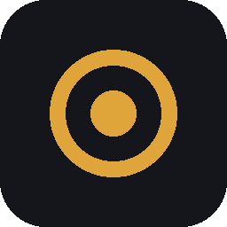
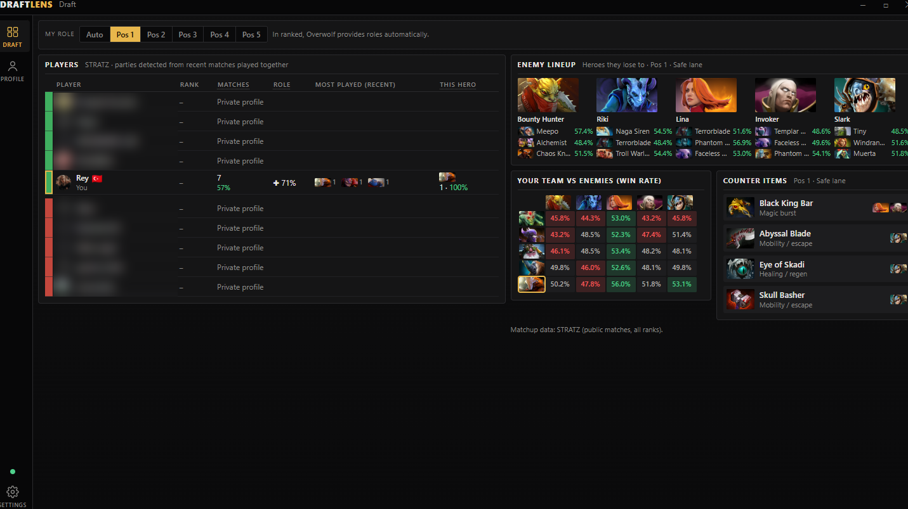
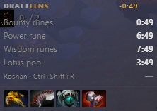
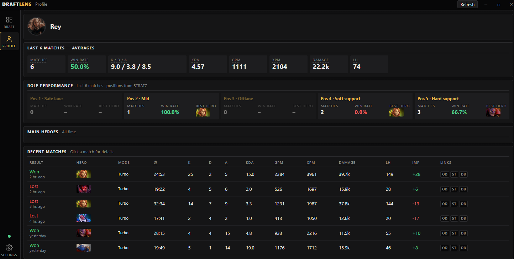

<h1 align="center">DraftLens</h1>

A free, lightweight Dota 2 companion app for <a href="https://www.overwolf.com/">Overwolf</a> (Windows). 
English · Türkçe · Русский · more languages coming

---

DraftLens is a minimal alternative to Dota Plus. It prepares draft analysis in a separate desktop window you open with Alt+Tab, and keeps only a small, transparent overlay on top of the game.

## Features

**Draft (hero selection)**
- Lobby player cards for all 10 players: rank, matches and win rate, core/support split, most played heroes, experience on the picked hero, and likely parties.
- Enemy lineup with the heroes that counter each enemy, filtered by your position and sorted by matchup advantage.
- Your team vs enemy team matchup matrix.
- Counter item suggestions for your role.

**In game**
- Small overlay with rune and Roshan timers and counter items.
- Hotkeys: `Ctrl+Shift+D` show/hide overlay, `Ctrl+Shift+R` mark Roshan killed.

**Profile**
- Match history with positions and IMP.
- Match details: all 10 players ranked by each stat, IMP and awards.
- Matches recorded on this PC, which still work when your Dota profile is private.

## Screenshots

| Draft | Overlay | Profile |
|---|---|---|
|  |  |  |

## Data

- Matchups, player cards, positions and IMP: [STRATZ](https://stratz.com) API.
- Match details and fallback: [OpenDota](https://www.opendota.com) API.

Responses are cached on the user's PC to keep API usage low. No account data leaves the user's PC except requests to these APIs.

## Status and roadmap

DraftLens is in active development. It is in testing on Overwolf (developer account approved) and the store release is coming soon.

- New features and improvements with regular updates.
- More interface languages beyond English, Turkish and Russian.

## Contact

Discord: happypower#2343

---

Data provided by STRATZ and OpenDota. DraftLens is not affiliated with Valve Corporation. Dota 2 is a registered trademark of Valve Corporation.
