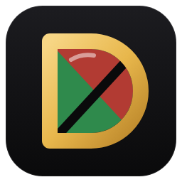
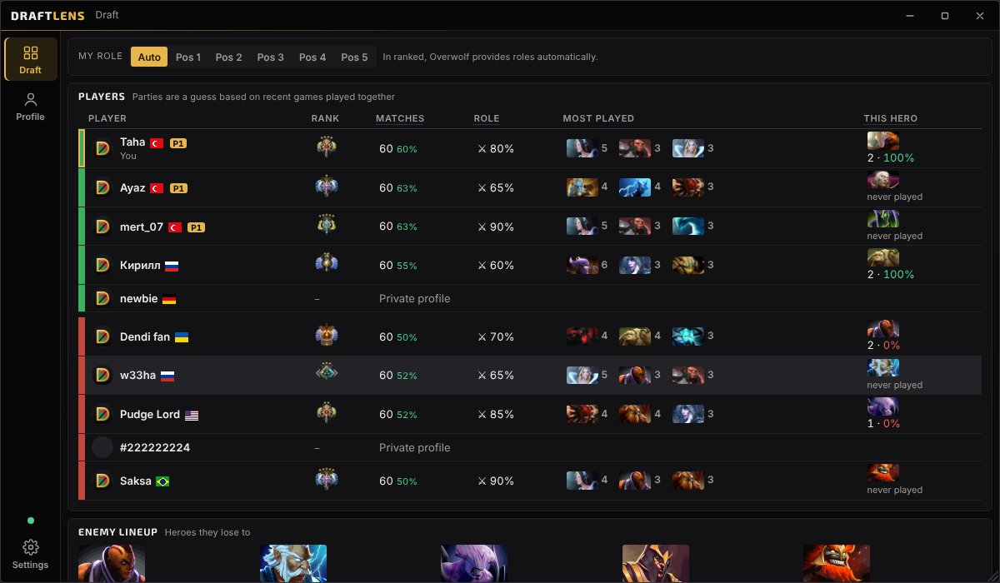
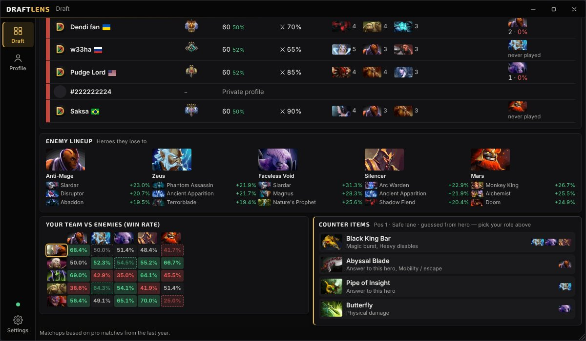
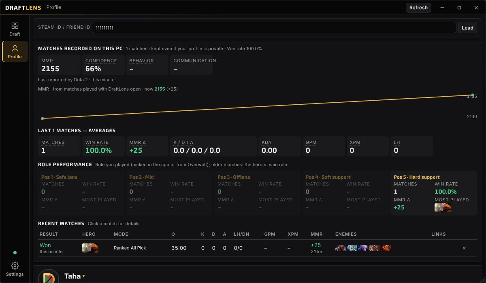
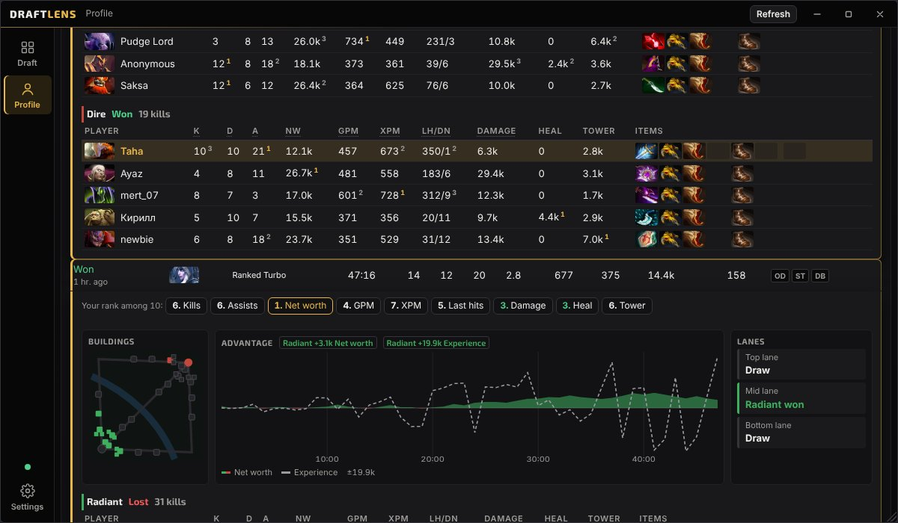
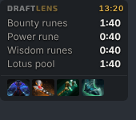

<h1 align="center">DraftLens</h1>

A free, lightweight Dota 2 companion app for <a href="https://www.overwolf.com/">Overwolf</a> (Windows). 
English · Türkçe · Русский · Español · Português · Deutsch · Français · Polski · Українська · 简体中文

---

DraftLens is a minimal alternative to Dota Plus. Draft analysis lives in a separate desktop window you open with Alt+Tab. On top of the game there is only a small, transparent overlay, and you can turn it off completely. There are never ads in the game or on the overlay.

## Features

**Draft (hero selection)**
- Player cards for all 10 players: rank, matches and win rate, core/support split, most played heroes, experience on the picked hero.
- Your own party marked from the game; other parties guessed from recent games together.
- Heroes that beat each enemy, filtered by position and sorted by matchup advantage.
- Team vs team win rate matrix, with an "if picked" preview row.
- Pick ideas for teammates who haven't picked yet.
- Counter items for your role, including hero-specific answers.

**In game**
- Small overlay with rune timers and counter items.
- Hotkeys: `Ctrl+Shift+D` show/hide, `Ctrl+Shift+M` move.
- Settings switch to keep the overlay off in every match.

**Profile**
- Match history with positions, KDA, GPM/XPM and links.
- Match details: all 10 players ranked by each stat, buildings, net worth graph, lane results.
- Matches recorded on this PC: MMR change per match, MMR and confidence, role performance. Works even with a private profile.

## Screenshots

Screenshots use sample data.

| Matches recorded on this PC | Match details | Overlay |
|---|---|---|
|  |  |  |

## Data

Player cards, match history and match details come from the public [OpenDota](https://www.opendota.com) API. Matchups are based on the last year of pro matches and adjusted with overall hero win rates. Responses are cached on your PC to keep requests low. DraftLens needs no API key and no account.

## Privacy

See the [privacy policy](https://tahakck35.github.io/draftlens-app/privacy.html).

## Status

Version 1.0 has been submitted to the Overwolf store and is under review. Updates will follow with fixes and new features.

---

Data provided by OpenDota. DraftLens is not affiliated with Valve Corporation. Dota 2 is a registered trademark of Valve Corporation.
